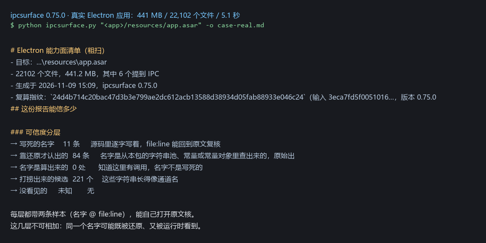
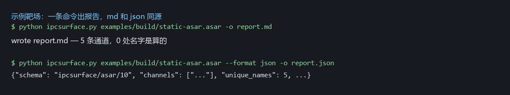
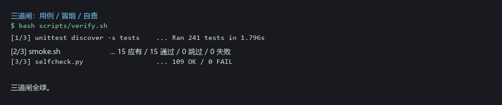

# ipcsurface

[](https://github.com/irrational51444/ipcsurface/releases)
[](tests/test_ipcsurface.py)
[](pyproject.toml)
[](LICENSE)

**Squash an Electron app's capability surface onto one page.** Zero dependencies beyond Python. Current version **0.65.5**.

Point it at an `.asar` archive (or a REA Evidence JSON, or a dll/exe) and get a report: how many IPC channels exist, which names are literal, which were recovered by deobfuscation, which only look like channels — and **how far you can trust the report itself**.

[中文 README](README.md) · [Changelog](CHANGELOG.md) · [Fixtures](examples/README.md)

---

## What it looks like

Against a real Electron app (441 MB, 22,102 files, 4.6 s):



One command, md and json from the same source:



Three gates, same set locally and in CI:



---

## Why "number of channels" is not the answer

Statements inside one report do not carry the same weight.

| Tier | Count in that real report | What it proves | What it does not prove |
| --- | --- | --- | --- |
| Literal names | 11 | Written verbatim in source; `file:line` lets you check the original | Only covers literal spellings |
| Recovered names | 84 | Name came out of a string pool or constant table; provenance is still in source | Found ≠ actually a channel |
| Computed names | 0 | We know there is a call here, the name is not literal | What the name is — not computable |
| Harvested candidates | 221 (51 written by the app itself) | These strings look like channel names | Looking like one is not being one |
| Unseen | unknown | Nothing | This path cannot see it; that is not proof it is absent |

**The tiers must never be summed.** One name can be both recovered and seen at runtime, and both rows will count it. The report is a map for a human decision, not a verdict.

---

## Install

```bash
pip install .
# or run it without installing
python ipcsurface.py app.asar
```

Python 3.9+, no third-party packages.

## One-minute tour

```bash
python ipcsurface.py app.asar -o report.md              # markdown
python ipcsurface.py app.asar --format json -o r.json   # machine-readable
python ipcsurface.py app.asar --baseline last.json      # only what is new
python ipcsurface.py app.asar --fail-on high            # exit 2 for CI
```

Try the bundled fixtures (build them first):

```bash
cd examples && bash build.sh
python ipcsurface.py build/static-asar.asar -o report.md
```

---

## Three rules of the report

**1. Unknown is `null`, never `0`.** Not seeing something is not the same as it not being there; `0` reads as "confirmed absent".

**2. Evidence records provenance, never a verdict.** Every channel carries `evidence`: where the name came from and how strong it is. Strength orders **review effort**, not probability.

**3. Consumers must check `schema` first.** Today it is `ipcsurface/asar/10`. If it does not match, stop — do not guess from field presence.

---

## Exit codes

| Code | Meaning | What to do |
| --- | --- | --- |
| 0 | Success, no gate triggered | See the `kind:` line on stderr for durability |
| 1 | Bad input (missing file, not an asar, bad flag) | Fix the input |
| 2 | `--fail-on` threshold hit | Read the suspicious items |
| 3 | The tool itself crashed | File an issue |
| 4 | Written but not durable (directory fsync failed) | **The file is already the new version — do not roll back or re-run** |

Write failures print one `kind: <class>` line on stderr.

---

## Machine-readable error kinds

Input: `file_missing`, `empty_input`, `encoding_invalid`, `json_truncated`, `json_malformed`, `shape_invalid`, `depth_exceeded`.

Output: `disk_full`, `permission_denied`, `short_write`, `replace_failed`, `symlink_target`, `write_failed`, `invalid_json_output`.

Durability is tri-state: `yes` / `no` / `unknown`. `unknown` appears on platforms without directory fsync (Windows); the exit code stays 0 and stderr says "cannot confirm durability" once.

---

## How quality is held

- **198 test cases**, standard library only: `python -m unittest discover -s tests`
- **15 smoke items**: every CLI entry point actually executed
- **Self-check**: version, schema, rule registry, docs-vs-implementation, clean worktree
- One command for all three gates: `bash scripts/verify.sh` — CI runs the same script

CI also checks the exit-code contract: a clean archive must exit 0, a dirty one must exit 2, and SARIF must upload.

---

## Known limits

- String-level scan, no syntax tree; concatenated or computed names stay invisible. Use REA Evidence when you need precision.
- Sandboxes, native modules, and channels wired up only at runtime are invisible statically.
- On Windows directory fsync is unavailable, so `durable` is `unknown`; symlink refusal and replace-under-lock paths have never run on a real system. Recorded in the [changelog](CHANGELOG.md).
- `adv-asar.asar` is a hand-made adversarial fixture with no build script; it exists only on the author's machine.

---

## Design rules (for whoever changes this next)

1. Never report the unknown as known.
2. Every failure states where it broke and what to do next.
3. Turn discipline into assertions, not into README sentences.
4. Tests must prove both "blocks what it should" and "allows what it should".

---

## License

MIT — see [LICENSE](LICENSE).
