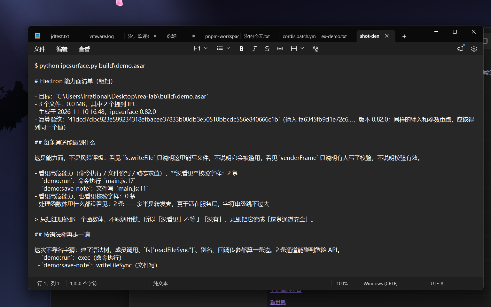
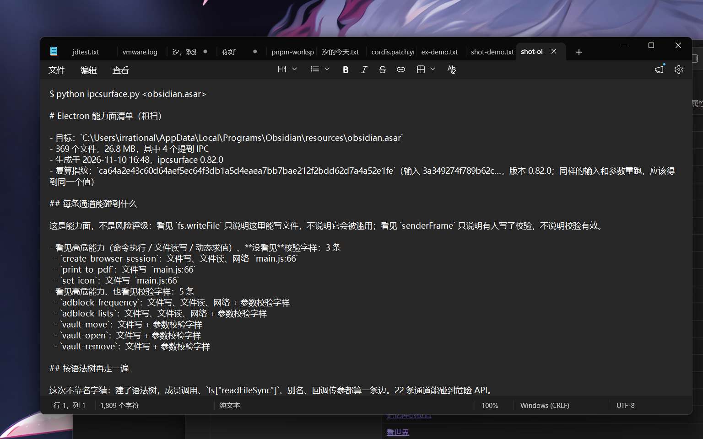

# ipcsurface

[](https://github.com/irrational51444/ipcsurface/releases)
[](tests/test_ipcsurface.py)
[](pyproject.toml)
[](LICENSE)

**把一个 Electron 应用的能力面压成一页纸。** 零依赖，只装 Python。当前 **0.145.0**。

`ipcsurface` 读一个 `.asar` 包（或 REA 的 Evidence JSON、一个 dll/exe），输出报告：
有几条 IPC 通道、哪些名字是写死的、哪些是还原出来的、哪些只是长得像——以及
**这份报告能信到什么程度、你凭什么自己核对**。

[English README](README.en.md) · [变更记录](CHANGELOG.md) · [示例靶场](examples/README.md) · [已知会错的地方](docs/known-wrong.md)

---

## 真跑一次

本机一个真实的 Electron 应用，441 MB、22,102 个文件，5.0 秒：


一条命令出报告，再拿人工标注对账（召回 / 精确 / 总覆盖率）：


三道闸，本地和 CI 跑同一套：


---

## 两个例子，都是真跑出来的

### 一、靶场：三条通道，一条安全、一条写文件、一条执行命令

样品不用我发，一条命令就能造出来：

```bash
python scripts/make_demo_asar.py build/demo.asar
python ipcsurface.py build/demo.asar
```



这份报告说明三件事：`demo:ping` 什么都没碰到；`demo:save-note` 能写文件、
`demo:run` 能执行命令；而且这两条**外部输入直接到了危险参数上**——
这是「该动手看」的那批，不是提醒。

### 二、真机：Obsidian 的 `obsidian.asar`（28 MB，369 个文件）

```bash
python ipcsurface.py "/path/to/Obsidian/resources/obsidian.asar"
```



**47 条通道、116 条危险 API、硬档 25 条**（人工读过源码确认的那批）。
其中 5 条通道的**危险调用实参直接来自 IPC 参数**——`copy-asar`、`print-to-pdf`、
`set-icon`、`vault-move`、`vault-open`。

---

## 现在能回答什么

报告是分层的，每一层回答一个问题，也各自标着「答不了什么」。**这几层不可相加**
（同一个名字可能既被还原、又被运行时看到，两边都会算它）。

### 一、这栋楼有几扇门？→ 通道清单

obsidian：**47 条**。写法分四档——写死的 0 条、靠还原的（字符串池/常量表）47 条、
名字是算出来的 0 条、捞出来的候选 221 个（其中 51 个是它自己写的）。

### 二、门后有什么？→ 危险 API

每扇门后面能碰到的危险调用（写文件、执行命令、删目录），**116 条**。每条带档位：
直连 / 双口径证实 / 同文件函数链 / 同名多义借来 / 仅语法树借来。**只有前四档共 25 条
算硬结论**，其余不用核也不用信。

### 三、外部的手能伸到门后吗？→ 污点三层

- **L1 零跳**：危险调用的实参**就是** IPC 参数本身。obsidian 有 **5 条通道**。
- **L2 一跳**：脏值先经过 `path.join` / `resolve`，再进危险调用。**3 条通道**。
  每条还带一个判定：这个 `join` 的根是**锚定**在固定目录上，还是**能跳出去**，
  还是**根看不见**。判定分五档：`锚定` / `可跳出` / `根是形参` / `根是局部变量` /
  `根看不见`。
- **L3 跨函数**：脏值传进同文件的另一个函数，再流到危险参数。obsidian **0 条**。

### 四、值会不会被存下来、下一轮再用？→ 状态字段

`C.icon = i` 这种：参数写进模块级字段，几个语句之后 `rmSync` 拿它去删文件。

obsidian 有 **9 条通道**是这种形状。两条都报：**写的地方**、同一个函数体里
**读它的地方**，还标出每处读是「读」还是「删」、是「写入之前」还是「之后」、
落在哪个调用的实参里。

```
set-icon  .icon ← i
  写：(i?C.icon=i:delete C.icon)
  读（写入之前，用的是上一次请求留下的值，在 F.join(...) 的实参里）
```

**这一层到此为止**：状态字段的生命周期跨请求，要知道下一次读它时里面是什么，
得做堆建模——那是做不到的。这里只给两个位置，连不连得上要人去看。

### 五、这些代码是怎么拼起来的？→ 作用域 + 模块图 + 改名

- **块作用域**：压缩产物把 `v` 这样的名字复用上百次，靠正则追根一定追错。
  按 `{}` 的父子关系判断「这个声明对这个位置可不可见」，才敢说根是什么。
  obsidian 的 `F.join(v, C.icon)` 里，`v` 解出来是 `app.getPath("userData")`——
  于是 L2 那两条从「根看不见」变成「锚定」。
- **解构改名**：`const {ipcMain: a} = require("electron")` 之后，文件里再没有
  `ipcMain` 这个词。只写字面量的话，**整个应用一条通道都报不出来**——
  ACLOS 就是这样从 0 条变成 285 条的。
- **模块图**：`app.js` **195 个模块 / 304 条依赖边**；`quicklook.js` 166 / 269；
  `lib/mermaid.min.js` 1；`main.js` 没有模块表（单文件打包）。

**模块图是适用，不是全能**：它能回答「谁引用谁」，回答不了动态 `require`
（`n(变量)`、`n("a"+b)` 现在直接丢掉）。

**跨模块搬值试过了，obsidian 上解出 0 处。** app.js 有 28 处 `n(id).名字`，
quicklook.js 有 20 处，导出表里一条也对不上——因为 `e.exports = a` 这种整体赋值
占了绝大多数，成员挂在 `a.X` 上，不在模块体的 `t.X` 上。要跟进去得做对象形状分析，
那是另一个量级。报告里这一格写「解出/共」，0 就是 0。

**跨模块 handler 在本机 8 个真包里是 0 例。** `ipcMain.handle('x', mod.fn)` 这种写法，
3.6 万个 js 文件里一个都没有；唯一的非内联 handlers 是 `this.onLogEvent` 这类
类方法引用（3 条），现在能把方法名当符号跟进方法体。

---

## 为什么不是「扫出通道数」就完事

同一份报告里的话，强度不一样。上面那份真实报告：

| 这一层 | 数量 | 能证明什么 | 不能证明什么 |
| --- | --- | --- | --- |
| 写死的名字 | 0 条 | 源码里逐字写着，`file:line` 能回到原文复核 | 只覆盖写死的写法 |
| 靠还原才认出的 | 47 条 | 名字从字符串池/常量表里查出来的，出处还在源码里 | 查得出不等于它真是通道 |
| 名字是算出来的 | 0 条 | 知道这里在调用，名字不是写死的 | 名字是什么，算不出来 |
| 捞出来的候选 | 221 个（51 个它自己写的） | 这些字符串长得像通道名 | 长得像不等于就是 |
| 没看见的 | 未知 | 无 | 这条路看不见，不代表它不在 |

**这几层不可相加。** 报告是地图，不是判决书。

**「221 个候选」这个数到底有多准？** 有数字的部分就报数字，没有的就写没有。
先分档，再谈准不准——分档只用能机械判的事实（是不是通道名、在不在含 IPC 的文件里、
同前缀几个），不做语义猜测：

| 档位 | 真实应用 | 意思 |
| --- | --- | --- |
| 就是通道 | 41 | 和静态看见的通道名对上了，不用再猜 |
| 在含 IPC 的文件里 | 10 | 名字躺在注册表或调用旁边，最值得先看 |
| 同前缀成簇 | 89 | 像一张名字表，`tool` / `js` 这类前缀最多 |
| 零星 | 81 | 只在别处出现，最可能是噪音 |

**要人工看的从 221 个降到 51 个**（前两档）——前档那 41 条就是和静态看见的通道名对上的，
其余 170 个默认只报数量、加 `--all` 才展开。
剩下的 180 个孤证里，**准确率未知**——没有人工核对过，编一个数比留空更坏。

还有一层这张表里没有，因为**这个包 0 条**：穷举出来的名字（`enumerated`）。
取值集合是源码里的字面量数组、拼法是字面量加参数时，
`for (const op of OPS) ipcMain.handle(makeChannel(op))` 这种能算成三个具体名字。
靶场 `dyn` 里就是三条，真实应用很少这么写。证明齐了是 `0.9`，缺证明降到 `0.6`，
哪条没过写在 `enum_proof.failed` 里。

---

## 安装

```bash
pip install .
# 或者不装，直接用
python ipcsurface.py app.asar
```

要求 Python 3.9+，没有第三方依赖。

## 一分钟上手

```bash
python ipcsurface.py app.asar -o report.md              # markdown
python ipcsurface.py app.asar --format json -o r.json   # 机器读的
python ipcsurface.py app.asar --baseline last.json      # 只看新冒出来的
python ipcsurface.py app.asar --fail-on high            # 有高危项退 2，挂 CI
```

自带靶场可以直接试（要先造包）：

```bash
cd examples && bash build.sh
python ipcsurface.py build/static-asar.asar -o report.md
```

---

## 这份报告的三条规矩

**一、未知写 `null`，不写 `0`。** 没看见不等于没有；`0` 会被读成「确认没有」。

**二、证据只记来源，不下结论。** 每条通道都带 `evidence`：名字从哪来、强度多少、
**哪几种观察能推翻它**。强度排的是复核成本，不是概率。

**三、消费方必须先校验 `schema`。** 现在是 `ipcsurface/asar/35`；对不上就停下，
别按字段在不在猜。

---

## 可信度靠什么撑起来

不是靠形容词，靠六件能被别人自己核对的事：

- **报告自指纹 `content_digest`**：报告正文（去掉时间戳和它自己）的 sha256。
  谁拿到都能重算——对得上，说明没被改过、也不是别的版本生成的。
- **包级 Merkle 根 `archive_merkle`**：包内每个文件的 `路径:sha256` 排序聚合，
  确认「我们说的是同一份包」。
- **完整性凭证都带 `claim` 字段**：`proves` 是「同一份东西、生成后没被改过」，
  `does_not_prove` 明写不是 `safety`、不是 `absence_of_backdoor`，
  `security_rating` 恒为 `false`。以前「这不是安全评级」只写在说明里，
  现在它是报告里的一格，读的人绕不过去。
- **输入指纹 `fingerprint`**：输入 sha256 + 版本 + schema + 参数 + 通道名，一起算。
  同输入重跑必须同值；输入读不到就是 `null`，不编。
- **每条结论配「推翻它的判据」**：`evidence[*].refutes_if` 写的是「什么观察能驳倒这条」，
  不是「什么能支持它」。
- **每层给样本，JSON 给全量**：md 每层抽两条 `名字 @ file:line`（按名字 sha1 选，
  谁的机器上都一样）；JSON 里 `sites` 给全部位置，`evidence[*].where_all` 给每个名字的所有位置。
- **人工标注对账**：`tests/golden/ground_truth.json` 是逐份源码数出来的通道清单，
  `scripts/ground_truth_check.py` 算召回 / 精确 / 总覆盖率。**当前平均总覆盖率 1.00**——
  四个靶场全对上了。这个 1.00 只说明这四个靶场（加起来 23 条通道、写法全是我自己写的），
  不代表真实应用。

交叉强度的四档（`strong` / `medium` / `weak-same-line` / `weak-near-line`）不是摆设：
探针在 probe JSON 里给 `sites`（名字 → `file:line`），工具就按两侧位置算档。
**探针只报名字、不报位置时才是 `unknown`**——那是没算，不是没对上。这四个档都用真实 CLI 跑出来过。

---

## 退出码

| 码 | 意思 | 该做什么 |
| --- | --- | --- |
| 0 | 成功，没有触发门禁 | 持久性看 stderr 的 `kind:` 行 |
| 1 | 输入有问题（文件不存在、不是 asar、参数不对） | 照提示修输入 |
| 2 | `--fail-on` 被触发 | 看报告里的可疑项 |
| 3 | 工具自己崩了 | 报 issue |
| 4 | 已写入但未持久化（目录 fsync 失败） | **文件已是新版，不要回滚、不要重跑** |

发布脚本的退出码是另一套：`0` 成功、`1` 守卫红或 release 已存在、`2` 守卫查不到、
`3` 脚本自己出错。**非零不等于失败**，这几种要分开。

---

## 写入可靠性 / 崩溃残留

报告「要么完整、要么不动」：先写同目录临时文件、`fsync`、核字节数，再 `os.replace`
原子换上去。任何时刻从约定路径读到的都是完整报告。

- **目录 fsync 失败**不等于写失败，内容已替换，只是崩溃后可能回退。`durable` 是三态：
  `yes` / `no` / `unknown`；`unknown` 只在「这套系统根本没有刷目录的办法」时出现，退出码仍是 0。
- **替换被占用**报 `replace_failed`，这次的正文留在 `.failed` 里当现场，原报告不动。
- **崩在中间**会留下 `.bak` / `.failed`，用 `--recover` 看：

```bash
python ipcsurface.py --recover out.md
```

只给事实、不动文件：副本存在只说明「上次可能崩在替换与清理之间」；target 缺失时
整张对比表退化成副本清单（大小、年龄、年龄的时间来源都保留），不留半张只有一侧的表。

## 错误词表（机器可读）

输入侧：`file_missing`、`empty_input`、`encoding_invalid`、`json_truncated`、
`json_malformed`、`shape_invalid`、`depth_exceeded`。

输出侧：`disk_full`、`permission_denied`、`short_write`、`replace_failed`、
`symlink_target`、`write_failed`、`invalid_json_output`。

---

## 质量怎么保证的

- **542 个用例**，只跑标准库：`python -m unittest discover -s tests`
- **性能门禁**：`python scripts/perf_check.py`，固定种子造包测吞吐，低于下限 CI 红
- **分支覆盖率 67%**，只许涨不许跌：`python scripts/coverage_check.py`
- **冒烟 15 项**：真跑一遍 CLI 的所有入口，跳过也出声，汇总行由脚本自己算
- **输入解析 fuzz**：`python scripts/fuzz_smoke.py` 字节级变异 asar 头 / PE 导入表；
  CI 里另跑 30 秒 atheris 真 fuzz
- **基准测试**：`python scripts/benchmark.py`，通道级 / API 级的精确率与召回率
- **可信度校准**：`python scripts/calibration.py`，按证据强度档和 sink 来路档分层算精确率
- **运行时对齐**：`python scripts/probe_align.py probe.json app.asar`
- **端到端**：`python scripts/e2e_check.py`，走装好的命令行，验 schema、口径、退出码、确定性
- **自查**：版本 / 打包元数据 / schema / 规则注册表 / 文档与实现一致 / 工作区干净 /
  已知会错清单的下限；`--fast` 跳过真包和冒烟，116 秒降到 20 秒
- 三道闸一条命令：`bash scripts/verify.sh`，CI 也跑它

CI 六个任务，缺一不可：`check`（Linux）、`windows`、`fuzz`、`probe`（xvfb + Electron）、
`signal`（SARIF）、`e2e`。

发布也不靠记性：`check_release_tag.py` 查标签指向的提交是否 CI 全绿
（`0` 绿 / `1` 红 / `2` 查不到，**还没跑完也算查不到**），`make_release.py` 先过守卫再发。

---

## 已知会错的地方

拼出来的名字看不见、长得像的字符串会误报、混淆器的痕迹只是线索——按
「看不见的 / 会误报的 / 别当结论用的场合」写在 [docs/known-wrong.md](docs/known-wrong.md)。

清单有机械下限：三列固定、症状条数不少于八条、顶部版本锁与当前版本一致，自检核对。
**内容是判断，自检保证不了它够具体**——这条边界写在 README 里，不装作能自动判断质量。

## 代码结构

主模块按层往外搬，搬一个验一个：

| 文件 | 管什么 |
| --- | --- |
| jsasar.py | asar 读取：头解析、文件表、按需切片 |
| jslabels.py | 报告要用的说法：时间戳、危险 API 归类、候选分档 |
| jsreport.py | 报告层：Markdown 渲染、基线比对、可信度分层、指纹 |
| jsparse.py | 词法：认不出的字符、未闭合的字符串都不再让整份分析作废 |
| jssem.py | 语义：污点传播、状态字段读写点、块作用域、模块表 |
| jsast.py | 语法树：成员调用、方括号、别名、回调连边 |
| native_imports.py | PE 导入表：原生模块能力面（加壳读不出就写「读不到」） |
| precise_engine.py | tree-sitter 精查层（opt-in）：跨文件 require、类方法跟随、循环枚举 |
| ipcsurface.py | 扫描、证据、报告、命令行 |

## 解析器的选型与边界

手写解析器的取舍、实测覆盖率和「什么情况下会翻案」写在
[docs/parser-decision.md](docs/parser-decision.md)；它认哪些语法、不认哪些，一条条列在
[docs/known-wrong.md](docs/known-wrong.md) 的「解析器语法边界」一节。
覆盖率能用 `python scripts/ast_coverage.py` 在任意包上重测。

## 已知边界

- 字符串级粗扫，不建完整语法树。拼出来的名字只有一种能算：取值集合是字面量数组、
  拼法是字面量加参数，那就穷举；取值来自配置、函数返回值或循环累加的一律退回「算不出来」。
- **块作用域是近似**：没建模 `var` 提升（`var v` 在声明前就能用，这里算不可见）、
  没建模 `catch(v)` 和 `for (let v of ...)` 的隐式块。解不出就退回「根看不见」，
  不往有利方向猜——一个假的「锚定」比「不知道」更坏。
- **正则有长度上限**：提常量键的正则把标识符限到 80 字符、值限到 200 字符。
  不限的话，在一行 3.4 MB 的打包产物上会退化成几亿次回溯——实测从 13.6 秒
  变成十分钟都跑不完。更长的名字本来也不是通道名。
- **模块图只连静态边**：动态 `require`（实参是变量或拼出来的字符串）直接丢掉。
  跨模块搬值（`n(8813).CONST` 到底是什么）还没做。
- **状态字段跟不到下一轮**：跨请求的对象生命周期要堆建模 + 过程间分析，不做。
- 沙箱、原生模块、运行时才装配的通道，静态看不到。
- Windows 上目录刷盘用 `ctypes` 调 `FlushFileBuffers`。只读卷和网络盘没实测过——
  那种情况下报 `durable=no`，不是 `unknown`。
- **「0 条」的读法**：channel_sinks 是粗扫口径，channel_sinks_ast 是语法树口径。
  两条都为 0 时只能读成「这个包里没连到」，不是「确认没有」。
- 规模与性能的断言可以**由外部复现**：
  `python scripts/make_scale_asar.py out.asar --files 22102 --mb 441` 按固定种子造出
  同量级的包，再跑 `python ipcsurface.py out.asar --format json`。

---

## 维护者自查（写给改它的人）

- 用例数、冒烟项数只写在上面「质量怎么保证的」那一节，别处引用不重写——两处会漂。
- 全称断言的空集合防护按语义判：内建集合操作（`len`、`sum`、`count`、`index`、`sorted`、
  `set`、`all`/`any`、推导式、空容器）算集合自身属性；用户自定义函数、依赖外部状态的调用
  才算「函数返回值」，一律保守归真空。
- 发布前跑一次 `python scripts/check_release_tag.py v<版本>`。它的 `2` 是「查不到」，
  不是「CI 红」。
- 注释豁免要贴着断言写（中间不许夹语句），比率当前是 **5 / 8**（真空断言口径）——
  这个数涨了就是信号。另外 3 处没走注释豁免，用的是 `non_empty()` 前置断言。
- **本轮教训**：先说「做不到」，再去做；做完要给出「影响了几条结论」的数字。
  没有数字的改动不算做完了。

## 设计原则（写给以后改它的人）

1. 不把不知道报成知道。
2. 每个失败说清坏在哪、下一步做什么。
3. 纪律变成断言，不变成 README 里的一句话。
4. 测试要证明「该拦的拦住了」和「该放的放过了」，两条都要。

---

## 许可

MIT，见 [LICENSE](LICENSE)。
