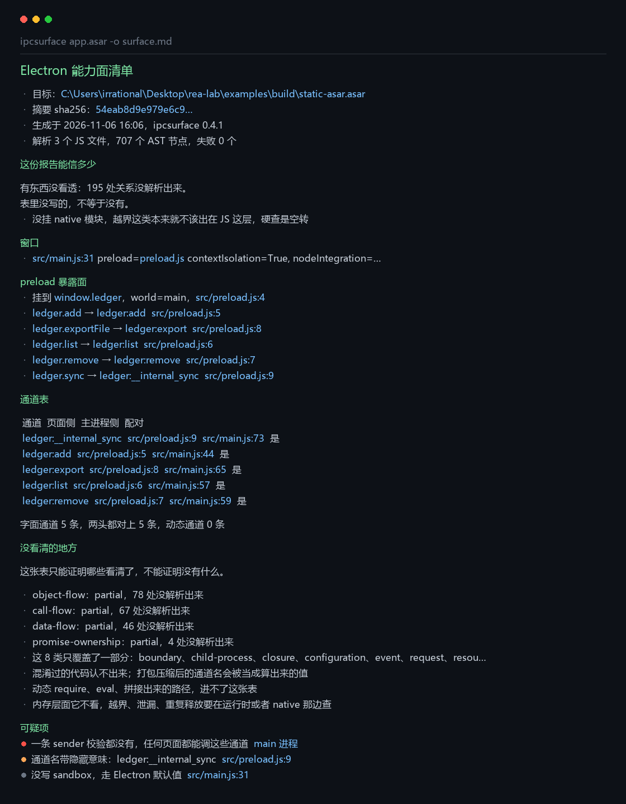
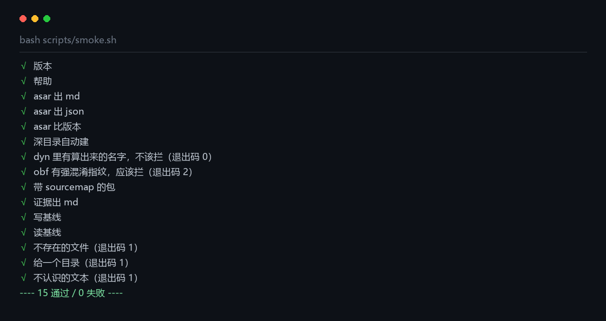

# ipcsurface

**把一个 Electron 应用的能力面，压成一页纸。**

[](https://github.com/irrational51444/ipcsurface/actions/workflows/ci.yml)
[](CHANGELOG.md)
[](tests/test_ipcsurface.py)
[](pyproject.toml)
[](ipcsurface.py)
[](LICENSE)

> 徽章都是仓库里自己的 SVG，不连 shields.io——那层代理在国内经常是空的，图会挂成一条竖线。

---

## 它解决的问题

Electron 应用的能力，一半在主进程里。渲染进程碰不到文件、碰不到磁盘、碰不到网络底层，全都要过 `ipcMain` 那几扇门。

门是 preload 拿 `contextBridge` 开出来的。开的时候没人记账，半年后就没人数得清有多少扇、哪扇通向哪里、哪扇是谁加的。

这个工具把这些门摆到一页纸上，并且**先说这份纸能信几成**。

---

## 三种输入

| 输入 | 需要什么 | 准到什么程度 | 适合什么时候 |
| --- | --- | --- | --- |
| `app.asar` | 只要 Python | 字符串级，带几道还原 | 刚拿到包，想知道值不值得认真查 |
| REA Evidence | Python + REA | 语法级：建图、跟作用域、带行号 | 真要出结论 |
| `x.dll` / `x.exe` | 只要 Python | 导入表：只说引了哪些外头函数 | 往下走一层，看它靠什么干活 |

三种都出同一套报告，第一节永远是「这份报告能信多少」。

---

## 名字藏起来了怎么办

真实应用发出去是压过的，`ipcMain.handle('vault:unlock')` 会变成 `a.b(c[3], d)`。这是字符串级扫描的死穴。

但真名往往还在包里，只是换了写法。下面几道还原全在粗扫里自动跑，一道都**不执行目标里的代码**：

| 手法 | 长什么样 | 怎么还原 |
| --- | --- | --- |
| 字符串池 | `var _0x=['vault:unlock',…]` 配 `_0x[0]` | 找到全是字符串的数组，下标换回字面量 |
| 死拼接 | `'ledger:' + 'shadow'` | 两头都是字面量，折成一段 |
| 模板串 | `` `ledger:${'tpl'}` `` | 插值是写死的，摊平；带换行的不摊，免得行号偏 |
| 常量 | `const PREFIX='ledger:'` 配 `PREFIX + name` | 前缀代回去 |
| **常量对象** | `const CH = { boot: 'dsh-desktop:boot' }` 配 `ipcMain.handle(CH.boot)` | 收全包的常量对象建表，`对象.字段` 换成登记的值 |
| 跨文件 | 名字写在 `channels.js`，`main.js` 里 `handle(CHANNEL)` | 先把全包的常量和常量对象收成两张表，第二遍扫时查表 |
| 方括号取成员 | `ipcMain['handle']('vault:unlock')` | 认成员访问的两种写法 |
| unicode 转义 | `'vault:\u0075nlock'` | 字面量里预解码；控制字符不还原，免得把行数撑开 |
| 自解码函数 | `_d('\x71\x66…')`，函数体里逐字符异或 | 认函数体的形状，用纯 Python 算，套几层剥几层 |
| 打捞兜底 | 调用点认不出了，名字还在字符串里 | 抽出所有 `前缀:名字`，去噪，按位置列出来 |

**真包上的结果**：一个 441 MB、22,102 个文件的真实应用，粗扫认出 **41 条通道**，其中 41 条全是靠常量对象查出来的，一条都没逐字写在调用点上。兜底再捞 **221 个候选**，其中 **51 个是这应用自己写的**，剩下的是第三方库和测试的噪音。

从零翻起、拿 221 行名单翻、拿 51 行名单翻，是三件不同的事。后面两档差的就是这道分家。

---

## 安装

Python 3.9+，只用标准库。

```bash
pip install .
```

不装也行，`python ipcsurface.py --help` 直接跑。只有想用语法级分析才需要 REA：`npm install -g rea-agents`。

---

## 快速开始

**糙的**，一个包换一页纸：

```bash
ipcsurface app.asar surface.md
# wrote surface.md — 41 条通道，0 条可疑，0 处名字是算的
```

**准的**，两步：

```bash
rea analyze-javascript-application app.asar --detail summary --evidence_output evidence
ipcsurface evidence surface.md
```

**只报新冒出来的**：

```bash
ipcsurface app.asar --write-baseline base.json -o surface.md   # 第一次
ipcsurface app.asar --baseline base.json -o surface.md --fail-on high
```

审计工具不解决噪音就没人用。一上来二十条高危，看三遍就麻木了。基线让「这次改动引入了什么」成为唯一的问题。

**比两个版本**，升级后多了哪扇门：

```bash
ipcsurface old.asar --diff new.asar -o change.md
```

**往下走一层**，看一个 dll 靠什么干活：

```bash
ipcsurface some.dll -o imports.md
```

常用参数：

| 参数 | 作用 |
| --- | --- |
| `-o, --out` | 写到文件；不给就打到标准输出 |
| `--format json` | 三种输入都支持，字段见下面「机器可读」 |
| `--fail-on high` | 出现该级别及以上问题时退出码 2，可以挂 CI |
| `--diff OTHER` | 把输入当旧版，和另一份比 |
| `--baseline FILE` | 只报基线里没有的发现 |
| `--write-baseline FILE` | 把这次的发现存成基线 |
| `--no-eval` | 关掉自解码还原。默认开着 |
| `--deep-restore` | 还原多转几趟。默认一趟，实测多转没多认出东西 |
| `--runtime PROBE` | 并入运行时探针的结果 |
| `--poke POKE` | 并入真敲一遍的结果 |
| `--all` | 不截断 |

---

## 输出长什么样



真跑出来的，`examples/build.sh` 一遍就能复现。报告结构固定：先说能信多少，再列证据，最后说没看清什么。

---

## 报告怎么读

这是这个工具最要紧的一节。**同一条报告里的话，强度不是一样的。**

报告开头有一张表，每行写三件事：有多少、能证明什么、不能证明什么 / 下一步怎么办。真包上的样子：

| 这一层 | 有多少 | 能证明什么 | 不能证明什么 |
| --- | --- | --- | --- |
| 两条路都对上的 | 31 条 | 静态和运行时各看见一次，互不依赖 | 对上的是名字，不是行为 |
| 写死的名字 | 11 条 | 源码里逐字写着，能回原文复核 | 只覆盖写死的写法 |
| 靠还原才认出的 | 84 条 | 从字符串池、常量、常量对象查出来，出处还在源码里 | 查得出不等于它就是通道 |
| 名字是算出来的 | 0 处 | 知道这里有调用 | 名字是什么，算不出来 |
| 打捞出来的候选 | 221 个（51 个是自己写的） | 长得像通道名 | 像不等于就是 |
| 没看见的 | 未知 | —— | 我这条路看不见，不代表它不在 |

三条读法上的规矩，写进了 JSON 的 `usage_constraints`，也写在这儿：

- **六层是标签，不是分类。** 一个名字可能同时落在几层，别把那一列加起来当总数。唯一能当总数的是 `unique_names`。
- **强度是复核成本，不是概率。** 查表查出来的名字和逐字写着的，确定性没差别；差的是复核要看一处还是两处。
- **`strength` 说「最好的那条多硬」，`weakest_sources` 说「最薄的环节多薄」。** 一条 0.9 的记录里可能挂着 0.2 的来源，两个数不能互相替代。

---

## 让程序自己说

静态只能猜。这两步是问。

```bash
cd probe && npm install

# 读登记表：注册了哪些通道、窗口真实的 sandbox 值
node run.js 应用目录 6 > probe.json

# 真敲一遍：每条通道喂 undefined、空对象、十万字符、null
node poke.js 应用目录 6 > poke.json

ipcsurface app.asar --runtime probe.json --poke poke.json -o surface.md
```

读登记表那步，混淆是没用的——代码在磁盘上乱名，跑起来内存里是明文。真包上读到 **27 条 invoke 通道、6 个监听、1 个窗口**，窗口那三项是 `contextIsolation=true`、`nodeIntegration=false`、`sandbox=true`。

敲击那步分三档写，不是两档：

- **照收的**：喂什么都不看还返回结果，最值得看。真包上 0 条。
- **被拦下的**：原话是 `rejected IPC without a sender frame` 这类。真包上 26 条。这一档只证明**有个门**，证明不了门后面对参数做过校验——sender 管的是「谁在调」，不是「传了什么」。
- **门禁未知**：抛了错，但抛的不是拦截类的话。这条错误**不提供门禁信息**，既不能说有门，也不能说没有，要回去看代码。

**在真包上跑起来要过两道关**，都是实测撞出来的：

1. 单实例锁按 userData 目录加，探针默认给一份独立的 `--user-data-dir` 绕开；
2. 应用可能在未打包启动时要一个环境变量指路（比如 `DSH_DESKTOP_PRIMARY_RUNTIME_DIR`），不给就起不来、窗口一个都建不出来。

这套配方只在一个应用上验过，换个包大概率要重摸一遍，别当通用解法。

**注意**：敲击会真的执行目标代码。只对自己的靶子或明确授权的程序用。

---

## 拿一个真包从头走到尾

不是演习。一个 **441 MB、22,102 个文件**的真实 Electron 应用：

| 步骤 | 用时 | 结果 |
| --- | --- | --- |
| 粗扫 | 4.4 秒 | 41 条通道，捞到 221 个候选，峰值内存 411 MB |
| 语法级 · 全量 | **十分钟没跑完** | 放弃，换下面的方式 |
| 语法级 · 挑文件 | 54 秒 | 产出 259 MB 证据 |
| 读证据 | 2.4 秒 | 一页报告 |
| 摊成目录给探针用 | 17 秒 | 22,102 个文件 + 7,727 个包外文件 |
| 探针 + 敲击 | 各十几秒 | 27 条通道、26 条被拦 |

三件事写进了代码里：

**全量语法级分析在大包上跑不动。** 读一遍和读懂一遍是两回事：两万多个文件读进来 0.3 秒，给每个建语法树、连引用、推数据流是另一笔账。正确姿势是先粗扫打捞，挑出可疑文件，再 `--source-path` 精查那一个。

**单文件分析缺上下文，就别硬下结论。** 只喂一个文件时看不到窗口代码，那「一条 sender 校验都没有」就不成立。

**证据大不等于慢。** 259 MB 的 JSON 读一遍 2.4 秒。

---

## 机器可读

`--format json` 给的不是「另一份人话」，是同一套判断的字段化版本。schema 现在是 `ipcsurface/asar/10`。

```json
{
  "schema": "ipcsurface/asar/10",
  "unique_names": 234,
  "channels": ["dsh-desktop:boot", "…"],
  "confidence": [
    {"id": "corroborated", "count": 31, "strength": 0.9, "action": "cite_with_caveat",
     "can_prove": "…", "cannot_prove": "…", "next_step": "…"}
  ],
  "evidence": {
    "dsh-desktop:boot": {
      "sources": ["harvested", "literal-resolved", "runtime"],
      "strength": 0.9,
      "strength_by_source": {"literal-resolved": 0.9, "runtime": 0.8, "harvested": 0.2},
      "weakest_sources": ["harvested"],
      "weakest_strength": 0.2,
      "corroboration": "static_runtime",
      "corroborated": true,
      "actions": ["spot_check_source", "triage", "trust_after_setup"],
      "primary_action": "triage",
      "independent_pairs": ["harvested+runtime", "literal-resolved+runtime"]
    }
  },
  "confidence_semantics": {"…": "规则都在这儿，不写在文档里"},
  "limits": ["…"],
  "baseline": null
}
```

几条定死的：

- **未知写 `null`，不写 0。** 0 会被下游读成「查过，没有」。
- **`primary_action` 只是先做哪件事**，不能替代 `actions`；主动性作取最严格的那个（`cite` < `spot_check_source` < `trust_after_setup` < `read_code` < `triage`）。
- **独立性有一张十组判定表**，不是几个例子：静态来源之间（`literal` / `literal-resolved` / `computed` / `harvested`）共享同一份源码，不算独立；运行时与任一静态来源算独立。每个名字的 `corroboration` 已按表算好。
- **`must_not` 是声明，不是闸门。** 它表示「工具声明了这条禁令、并且它有出处」，不表示「工具能检测你有没有遵守」。遵守责任在消费方。
- **消费方必须先校验 `schema` 号**，不匹配就拒绝解析。换号只保证你能察觉不兼容，察觉与否取决于你有没有看。

---

## 输出契约与 CI 信号

CI 只认三样东西：**退出码、可解析的结构、稳定的规则 id**。三样都定死在这儿。

**退出码**

| 码 | 意思 | 该做什么 |
| --- | --- | --- |
| 0 | 成功；没有触发门禁 | 持久性看 stderr 的 `kind:` 行 |
| 1 | 输入有问题：文件不存在、不是 asar、参数不对 | 照提示修输入 |
| 2 | `--fail-on` 被触发 | 看报告里的可疑项 |
| 3 | 工具自己崩了——不是目标的问题 | 报 issue |
| 4 | 已写入但未持久化（目录 fsync 失败） | **文件已是新版，不要回滚、不要重跑** |

代码里是 `EXIT_CODES`，测试直接断言这张表，改口径会红。`--help` 里也有这张表。

**写入的持久性有三态**（`WriteResult.durable`）：`yes` / `no` / `unknown`。`unknown` 出现在本平台没有目录 fsync 能力时（Windows），退出码仍是 0，只在 stderr 说一次「无法确认持久性」。把「没法确认」报成 `yes`，就是拿不知道冒充知道。

**三个计数不重叠**：自查会同时报「定义 158 / 实跑 157 / 跳过 1」。以前写「已执行 156 / 其中跳过 1」是自相矛盾的——跳过的那条没执行，却算进了执行数。这个项目连「3 处命中 vs 1 条通道」都要纠正，自己的计数更不能留这种歧义。

**md 报告有两条约束**：章节标题不许重复；md 里的通道数必须等于 JSON 的 `channels` 长度（这条出过事，41 对 52）。报告现在不带章节编号，用例里留了一条**反向守卫**——哪天有人开始给编号，它会红，而且红的时候消息里写的是「这不是回归，是前提变了，请补编号唯一检查后删掉本守卫」。守卫生来就是为了被删掉，但得让删它的人知道自己删的是什么。

**md 里的每个数字，谁在看着它**：

| md 里的数 | JSON 字段 | 谁在检查 |
| --- | --- | --- |
| 抬头「提到 IPC N 个」 | `facts['scanned']` | 自查第六节 |
| 「N 条通道」 | `channels` 长度 | 测试套件 `md_and_json_agree_on_counts` |
| 通道清单里的名字 | `channels` 内容 | 同一用例逐名比对 |
| 「N 处名字是算的」 | `dynamic` 长度 | **派生数字**：和 JSON 同一份 facts 渲染，源头被检查 |
| 可信度分层各行数 | `confidence[].count` | **派生数字**：同一份 `confidence_levels()` 输出 |

区分「派生数字」和「没被检查」很重要：前者不需要单独断言，源头有人看着；后者才是真缺口。这张表里目前没有后者——以后加了独立来源的数字，得写明「无任何检查，使用前自行核对」。

**全称断言先证非空。** 对空集合说「全都满足」平凡为真——`numbered: []` 那种绿比红更危险。

这一条由一条 AST 扫描用例守着。两条边界分开写：

- **空间边界**：扫 `tests/` 与 `scripts/` 下的 `.py`；产品代码不进这套扫描。但「不扫」不等于「不管」——自查会用 AST 单独回答「产品代码里有没有**扫描器认得的**全称断言」，当前 0 条。注意这个数字只说明没有那几种形态，不说明产品代码没有空集合问题；措辞别放大。这条是**门禁**不是观测：产品代码哪天真加了，自查会红，除非在断言上方写 `# universal-assert-ok: 理由`（≥10 字）。

门禁的证明边界要说清：**通过 = 没有扫描器识别的形态，不等于没有空集合平凡为真的断言。** 列表外的写法靠 review，这句话和上面「0 条只说明没那几种形态」是同一件事，分开读容易被合并成一句过强的结论。
- **模式边界**：只认四种形态——`assertTrue(all(...))`、`assertFalse(any(...))`、`not [x for x in xs if bad(x)]`、`for x in 参数: assert ...`。其他写法（`sum(1 for ...) == 0`、`len([...]) == 0`、`set(xs) <= set(good)`）**不在检测范围内**，需要人工 review 或扩规则。列举不是完备，写在这儿免得当成全覆盖。

保护形态按语义认，不按长相认。**判据是「空集合上会不会失败」**：

| 写法 | 算保护吗 | 为什么 |
| --- | --- | --- |
| `assert xs` | 算 | 空列表直接挂 |
| `non_empty(xs, ...)` | 算 | 同上，带说明 |
| `if not xs: raise/return/skip/fail` | 算 | 空集合走退出分支 |
| `assert xs is not None` | 不算 | 空列表能过 |
| `assert len(xs) >= 0` | 不算 | 任何集合都能过 |
| `assert xs == []` / `assert len(xs) == 0` | 不算 | 空集合恰好为真 |
| `if not xs: pass` | 不算 | 什么也没挡 |

**注释豁免的归属**：`# empty-allowed` 必须在该断言前 5 行内；一条注释只豁免离它最近的那个断言，多个断言共用一条注释时，远的那个照样算未保护。这是启发式，边界就写在这儿。

**循环规则的边界**：只认 `for x in 参数` 这种直接遍历；`for x in self.channels`、`for x in get_channels()` 不在检测范围——和 `sum(1 for ...) == 0`、`len([...]) == 0` 一样，属于**已知不在检测范围的写法**。

**遇到这些写法怎么办**：改成 `non_empty(xs, "为什么非空")`；或用不了的话，在断言上面写 `# empty-allowed: 理由`；两者都不合适就人工 review 并在 PR 里说明——不要只是知道它没被检查。

**不在列表里的形态，默认当危险报。** 这是刻意的方向：宁可吵，不可漏。`assert len(xs) == 0`、`assert xs == []`、`assert xs is not None` 这些「看起来在防空集合、其实空集合照样通过」的写法都会被报出来，要豁免就写注释。反过来（默认放过）会安静得多，但安静的那部分是盲区。

**注释的方向**：`# empty-allowed` 只豁免**它下面**的断言（向上找、向下生效），且注释与断言之间不许夹着别的断言。一条注释放行一片的日子没有了。

**豁免口的约束**：产品代码里的 `# universal-assert-ok:` 必须带 ≥10 字理由，否则自查红。自查每次都会报「合规豁免 N 条」——这个数涨上去就是信号。

**豁免率怎么算**：分子是「真的靠注释被放行的**真空断言**处数」，分母是「真空断言处总数」。

「真空断言」= 空集合上平凡为真的那种：`assertTrue(all(...))`、`assert not [...]`、循环体内断言、`len(x) == 0` 之类。另外两类**不进分母**：

- `assertTrue(any(...))` 是存在性断言，空集合直接失败，不会静默通过；
- `assertFalse(any(...))` 是「不该有坏东西」，空集合本来就该通过。

当前 **2 / 3 ≈ 67%**。上一版报的 91% 是把上面两类也算进分母算出来的——那不是豁免膨胀，是判据误报。

**双锁：锁比率，也锁版本。** `tests/golden/exemptions.json` 同时存 `locked_at_ratio` 和 `locked_at_version`。

- **比率一涨就红**（不是「涨 20 个点才红」）：上一版只锁版本时，同一版本内可以一点点加豁免而无人察觉；现在只要当前比率高于锁定值就失败，必须显式更新 `locked_at_ratio` 并写理由。这才把「确认没恶化」从人工承诺变成机器检查。
- **版本对不上也红**：防止换版本时静默沿用旧基线。当前版本号取自 `ipcsurface.__version__`（包源码），不是这个 JSON——改 JSON 里的字段改不动比较基准。
- 更新基线时必须写 `reason` 字段说明为什么涨是合理的。当前 91% 就是这么解释的：本套件的全称断言多是「不该出现某个东西」，空集合本来就该通过。
- **更新流程本身有用例**：`ExemptionLockTests` 证明三件事——只改比率不改版本仍然红、比率和版本都改但没写理由仍然红、三样都齐才放行。

**README 里的数字按分数比，不按百分比**：`10 / 11` 精确比对，避开四舍五入在 .5 边界制造假红。

**未扫描 ≠ 通过**：一个文件语法错误时，扫描继续，但结果里会分开报「扫描并通过 N 个 / 因语法错误未扫描 M 个」。M 里的断言完全没被看过，不能读成没问题。

这条检查只活在测试套件里，所以没有独立退出码：unittest 失败就是红。**「有危险断言」和「有文件没扫」都会红，但不会互相覆盖**——失败消息里两段分开写，先报未扫描的文件（因为那些断言根本没被检），再报未保护函数。

**未扫描的文件不进任何指标**：密度只按已扫描部分算，所以「有语法错误的代码库」密度会系统性偏低。这是已知盲区，用「未扫描 M 个」单独报出来——看到 M > 0 时，密度那个数要打折看。

**同一行两条断言**：行号相同，注释按行生效，两条一起豁免。这不是漏洞，是 Python 里 `assert a; assert b` 本来就共享一行。扫描器会提示「这一行有 N 条断言，建议拆行」——不阻断，但告诉写的人豁免范围比你以为的大。

**豁免的定位规则**（比行号严）：注释只豁免它下面那个断言。主判据是 AST——注释与断言之间不许夹任何语句节点；5 行只是辅助上限，防注释漂太远，不是核心规则。中间隔了 `with`/`if`/别的语句，就把注释贴着断言写。

**失败原因分三种**：`no_comment_nearby`（补一条注释）、`comment_too_far`（把注释挪近）、`comment_blocked_by_statement`（删掉中间语句或贴近写）。报错直接告诉你该做哪种动作。

以前还有第四种 `other_protection`（「已有 non_empty 但还是报」）——删掉了，因为那条路径不该存在：`non_empty()` 会被优先识别为保护，走到报错就说明真的没有保护。留着它只会让人分不清「扫描器漏识别」和「断言真缺保护」。

**for 和 try 的区别是设计出来的**：注释贴 `for` 上方算豁免（循环本身就是那个被检查的位置，空集合时循环不执行）；注释贴 `try` 上方不算（`try` 只是包裹，断言在体内，中间隔着语句节点）。两条都有用例钉着，免得以后当成 bug 改掉。

**豁免率的分母构成也会报**：失败消息里除了比率，还给「分布在多少个函数、平均每函数几处」——因为 10/12 和 10/200 是两种严重程度，只看百分比分不出来。

**嵌套循环是误判高发结构**：旧规则「整函数一条注释」最容易盖住嵌套里的断言，存量那 3 个报红全是这个形状。新代码在嵌套循环里加断言时，注释贴内层断言，不要写在外层循环上面。计数时嵌套断言按最外层算一条，但豁免仍要贴到具体那条断言旁。

**报告顶层键是有白名单的**（`REPORT_TOP_LEVEL_KEYS`），多一个键就有用例红。这条是把「别把 durable 之类写进报告」从文档承诺变成回归约束——README 只有读的人才记得，测试不读也会拦。

**durable 不进 JSON 报告。** 它是 `write_output` 的返回值，属于「这次写盘的行文」，不是「报告的内容」。所以这轮从 bool 改成三态，输出契约没变、schema 号没动——如果哪天把它写进 JSON，那才是破坏性变更，得升 schema 并写迁移说明。`kind: durability_unknown` 每次进程只打一次，免得变成背景噪音。

**输入错误的类别**（`INPUT_ERROR_KINDS`）

拒绝不是一句「读不动」。每条错误带类别，错文末尾有一行 `kind: xxx`：

| kind | 什么时候 |
| --- | --- |
| `file_missing` | 文件不存在或者没权限 |
| `encoding_invalid` | 不是 UTF-8 |
| `empty_input` | 空文件 |
| `json_malformed` | 不是合法 JSON |
| `json_truncated` | JSON 被截断，括号或引号没闭合 |
| `depth_exceeded` | 嵌套层数超过 `MAX_JSON_DEPTH`（64） |
| `shape_invalid` | JSON 合法但形状不对，比如 `handlers` 写成了字符串 |

有类别，下游才能自己决定重试还是放弃，不用去解析中文。`depth_exceeded` 是在解析**之前**数括号判出来的，不是撞上 `RecursionError` 再兜底——靠解释器递归极限兜底，换个 Python 版本行为就会漂。

**最该记住的一条**：`handlers` 写成字符串时，`len('a:b')` 会被当成三条通道。崩掉至少不会让人误信，静默报一个格式合法、数值错的数才是真危险。现在这类一律拒绝。

**写出去那一侧也是同样的规矩**（`OUTPUT_ERROR_KINDS`）

报告不是「写到哪算哪」。要么完整写出来，要么一个字节都不留：

| kind | 什么时候 |
| --- | --- |
| `disk_full` | 磁盘满 |
| `permission_denied` | 没有写权限 |
| `path_missing` | 目标目录不存在 |
| `short_write` | 写完了，但字节数对不上 |
| `write_failed` | 其他写入失败 |

做法是先写同目录的临时文件，`fsync` 之后核字节数——**能核的都在替换前核完**；旧文件用硬链接留一份副本（不支持就复制），target 本身不动；然后 `os.replace` 原子替换；最后读回来核指纹。

备份用 copy/link，不用 rename。把旧文件挪走会让 target 出现「不存在」的窗口，进程在这个窗口里被杀，旧内容就真丢了——那就不叫「只丢这一次」。替换那一步始终是 `os.replace`，任何时刻从约定路径读到的，都是一份完整报告。

顺序是：临时文件 → `fsync` → 核字节数 →（声明 JSON/SARIF 就在 tmp 上解析一遍）→ 复制一份旧版副本 → `os.replace` → 刷目录 → 删副本。

**能核的一律在替换前核完。** 替换之后不再核内容：`os.replace` 成功就说明 target 的内容等于 tmp，再比一遍是恒真，那条「核验不过就还原」的分支永远不会被真实触发，留着只会让人误以为 replace 会悄悄写坏。

几个明确的取舍：

- **目录 fsync 有三态，不是两态。** `_fsync_dir` 返回 `FsyncResult.OK / UNSUPPORTED / FAILED`；`durable` 对应 `yes / no / unknown`。`no` 才退 4 并打 `kind: not_durable`；`unknown`（Windows 那种没有能力的平台）退 0，打 `kind: durability_unknown`，stderr 说清「无法确认」。混成 bool 迟早把未知当失败，或者把未知当成功。
- **备份年龄只看文件名。** 名字里带毫秒时间戳，跨平台一个语义。用 ctime 是「碰巧在 Linux 上对」：那边它是 inode 变更时间，Windows 是创建时间，网络盘各说各话。用 mtime 更糟——`copy2` 会把原文件的修改时间带过来，一份三天前的报告，副本一诞生就「三天大」，立刻被当过期清掉。
- **时钟回拨按「太新」处理。** 时间戳比现在还晚（NTP 校正、手改时间、快照恢复），不删。年龄判断的可靠性上限就是系统时钟的可靠性，这句话写进注释。
- **只清自己生成的名字。** 严格匹配 `.{名}.{13位时间戳}.{8位hex}.bak` / `.failed`；你手工放的 `report.md.bak` 不动，也不会被误报成残骸。
- **删副本前先看 target 在不在。** 但这只是最小防线：它只防「target 缺失」，不防「target 存在但已被别人截断或改坏」。那种情况检查不出来，别把它当安全保证。
- **符号链接直接拒绝。** `copy2` 备份的是链接指向的内容，`os.replace` 替换的却是链接本身，两头不一致。报 `symlink_target`，错误里直接给出该用的真实路径。
- **不自动恢复，但会提醒。** 每次写之前扫同目录，发现未过期的 `.bak` 就在 stderr 说「发现 N 个未处理副本」。不替人判断谁对谁错，但不闷着。
- **replace 失败的现场留一份 `.failed`。** 那是「我们确实想写什么」的唯一证据；同样带时间戳，**6 小时**后按年龄清（副本是 24 小时，诊断件更短）。注意它里面是报告正文，可能带应用路径和通道名——留得越久，敏感内容留得越久。这是权衡，不是白拿的方便。清理按时间、不设数量上限：如果一个进程能反复制造 replace 失败，留存量就是「失败次数 × 6 小时」。

**跳过用例怎么算**：Windows 上会跳一条符号链接用例，`unittest` 报 `OK (skipped=1)`。自查的用例计数按「定义了多少个 test_」算，不按「跑了多少个」，所以跳过不会让计数红——代价是这个数字证明的是覆盖数量，不是每次都真跑过。这句话写在这儿，免得把它当更强的证据。

**测试矩阵**：`verify.sh` 在本地和 CI（Ubuntu）跑同一套用例。其中「真实文件系统」那类验的是真语义，「控制流」那类只证明调用顺序（比如 durable=False 只能靠 mock 注入，它证明的是「这个状态被正确传出去了」，不证明真实 ENOSPC 下 stderr 会怎么说）。代码里分两组标注。

**Windows 上明确「未验证」的行为清单**（CI 不跑，只能本地手动看）：

| 行为 | Windows 现状 |
| --- | --- |
| 目录 fsync | 不支持，`_fsync_dir` 返回 `None`，`durable` 视为真，退出码 0 |
| 符号链接目标 | 默认权限建不了链接，拒绝路径没在真实链接上跑过 |
| `os.replace` 目标被占用 | `replace_failed` 分支没在真实占用下跑过（只有 mock） |
| 长路径 / 只读目录 | 未测 |

**金标准快照**：`tests/golden/asar_report.json`，固定输入对应的 **JSON** 报告，逐字段比。更新它有三步纪律（想清是否有意、看清差在哪个字段、写进 CHANGELOG），写在 `tests/golden/README.md` 里——不写纪律的快照，最后一定会变成「红了就覆盖」。md 没有金标准，只有上面那两条结构约束。

**崩了以后磁盘上是什么状态**：`AssertionError` 属于代码 bug，走 fail-fast。它只可能在 `build_asar_report` 或写路径的 `finally` 覆盖范围内抛出：写路径的断言在 `try/finally` 里，残留由 `finally` 清；真发生在 `os.replace` 之后，`finally` 也会把临时文件和副本删掉。万一清理本身失败，下次运行的前置清理会按年龄收掉。

写在这儿的意思是：这些不是「不支持」，是「可能能用但没保证」。主要用户群在 Windows 上，这个差别比一句「CI 不跑」重要。

**三种输出，各有各的用途**

| `--format` | 给谁 | 说明 |
| --- | --- | --- |
| `md` | 人 | 默认。先说能信多少，再列证据 |
| `json` | 程序 | `schema` 号打头，字段见上一节 |
| `sarif` | CI 平台 | SARIF 2.1.0，GitHub 代码扫描直接吃 |

SARIF 里只放**可疑项**，不放通道清单——通道不是告警，塞进去会把告警计数搞乱。规则 id 稳定且是 ASCII：中文标题转不成 slug 时用文字摘要的哈希兜底，同一条规则每次都得到同一个 id，抑制和分类才做得起来。

**挂到 CI 上就这么写**

```yaml
- run: ipcsurface app.asar -o surface.md --fail-on high
- run: ipcsurface app.asar --format sarif -o ipcsurface.sarif
- uses: github/codeql-action/upload-sarif@v3
  with:
    sarif_file: ipcsurface.sarif
```

仓库自己的 `.github/workflows/ci.yml` 有两个 job：`check` 跑编译、用例、冒烟、自查；`signal` 专门验信号——干净靶子必须退 0，有问题的靶子必须退 2，再把 SARIF 传上去。第二个 job 不是在验工具，是在验「CI 到底能不能靠这些信号做判断」。


## 靶场

`examples/` 里有九个故意写坏的应用，源码是明的，答案在手上，跑完自己核分。

```bash
cd examples && bash build.sh
```

| 靶子 | 考的是什么 | 期望 |
| --- | --- | --- |
| `static` | 通道名全写死，藏一条 `__internal_sync` | 5 条通道、配对 5/5 |
| `dyn` | 四种算出来的名字 | 3 条进表，2 处留在「没看清」 |
| `obf` | 被压过的样子 | 认出强指纹，报告开头降级 |
| `obf2` | 字符串池 + 下标 | 4 条全认出 |
| `obf3` | 自解码函数 | 2 条，默认就还原 |
| `obf4` | 套两层自解码 | 1 条，剥两层 |
| `obf5` | 名字写在另一个文件里 | 2 条，靠全包常量表配上 |
| `bulk` | 八百条通道 | 报告不散架 |
| `native` | 带 `.node` 模块 | 说明「越界只在那些文件里」 |

另外有一组 **12 条对抗样本**，同一句 `vault:unlock` 换十二种写法（池子套池子、反转、base64、unicode、注释插在拼接处、方括号调用、名字放 json、模板套模板、`fromCharCode`、两跳变量……）。现在认出三处，另外九条如实标成「名字是算出来的」。

注意一件事：那三处用的是同一个名字，所以通道表里**去重后只有 1 条**。样本数和通道数不是一回事，写在这里免得下次自己看错。

这组样本比数字有用：它每次都在提醒，**认不出的时候不许装认出**。上一版就是它撞出来的——模板套模板会把输出拼坏，跨行模板摊平会让行号一路偏。

细节见 [`examples/README.md`](examples/README.md)。

---

## 自查

改完东西跑一遍，三十多项，全绿才算收工：

```bash
python scripts/selfcheck.py
```

查的是这些：版本号和 badge、README、CHANGELOG 对不对得上；schema 号；每条规则有没有对应用例；每个聚合字段的 `must_not` 有没有出处；真包实测数字（22,102 文件 / 41 条通道 / 221 候选）；报告里该有的话在不在；旧基线拦不拦得住；工作区干不干净、tag 推没推。

---

## 安全哲学

静态分析给不出答案，只能给材料。谁把它当判决书用，谁就是在赌。

所以这个工具在四处刻意慢下来：

**先说自己的可信度。** 报告第一节不是通道表，是这张表里每一层能证明什么。

**一条都没扫到的时候，顶在最前面喊。** 0 条字面通道不是「这包干净」，是「我这条路走不通」。那句「这份报告对有没有通道的答案是不知道」必须排在最前面，不能挂在末尾当免责声明。

**把看不懂的东西也列出来。** 算不出的名字不跳过、不猜、不归到「其他」。表达式原样贴出，位置原样标出。

**不替你做危险的决定。** 会执行目标代码的那一步（敲击）默认不动手；不会执行的那一步（自还原）默认开着。

---

## 它不干什么

- **不执行目标** —— 除了敲击那一步，而且那一步要你自己点名。
- **不还原全部字符串表** —— 路径、密钥这类普通常量不一定提得到，自己再 grep 一遍更稳。
- **不折叠算术** —— `7 * 60 * 1000` 不会变成 `420000`。
- **不做 native 二进制** —— 那是 Ghidra / Hopper / IDA 的活。
- **不查内存** —— 越界、泄漏不在静态语法里，真要看就下到 native 模块或者上运行时。
- **不写完整的 JS 解释器** —— 所以「函数拼 + 循环展开」「控制流平坦化」这类还原不了。
- **不把「对上」当成安全** —— 对上的是名字，不是行为。门后逻辑一律没审。

后面几条不是免责声明，是报告里的固定一栏。

---

## 开发

```bash
bash scripts/verify.sh    # 三道闸一条命令：用例、冒烟、自查
```

也可以一条一条跑：

```bash
python -m unittest discover -s tests -v   # 184 个用例，只用标准库
bash scripts/smoke.sh                     # 把每条命令真跑一遍，十五项
python scripts/selfcheck.py               # 三十多项自查，含真包实测
```

`verify.sh` 存在的理由很土：规矩写在文档里会被跳过，写成一条命令才有人真跑。任何一道闸红，它自己就非零退出。



单元测函数，冒烟测命令行，自查测「说的和做的对不对得上」。分开是因为它们挂的原因不一样：函数写错是逻辑问题，命令跑不通是参数问题，文档写得比实现漂亮是第三种问题。

**规则要配用例，而且这件事自己也得被检查。** `RULES` 是一张登记表，每条规则一个 id，测试套件里有一条 meta-test 扫全部用例，缺了就红。但要说清楚：meta-test 只保证「每条规则都有用例」，不保证「用例真的在测那条规则」——它防的是缺用例，不防用例无效。

---

## 为什么只有一个文件

两千一百多行，没有依赖。

因为它只做一件事：把上游已经算好的东西，按人能读的顺序摆出来，顺便把藏起来的名字尽量捞回来。这件事不值得一个框架。

REA 负责拆，这个脚本负责摆和还原，人负责判断。三段分开，每段都能单独验。

---

## 发布

当前 **0.54.0**。每个版本打一个 tag，全部版本在 [Releases](https://github.com/irrational51444/ipcsurface/releases)，逐条改动在 [CHANGELOG.md](CHANGELOG.md)。

```bash
git clone https://github.com/irrational51444/ipcsurface
cd ipcsurface
git checkout v0.54.0
python ipcsurface.py --version
```

近几版一句话一个：

| 版本 | 一句话 |
| --- | --- |
| 0.54.0 | 自查抓到通道口径不一致：报告 41 条，基线存了 52 |
| 0.30.0 | 补正向扫描：新字段靠「有没有登记」判定，不靠名字像不像 |
| 0.29.0 | 聚合字段登记表：第四次加聚合字段时检查先红 |
| 0.28.0 | 两个强度各管一件事：最好的多硬 vs 最薄的环节多薄 |
| 0.27.0 | 对上不再均质，每个名字带分侧强度 |
| 0.26.0 | 独立性改成十组判定表；基线自带 schema |
| 0.25.0 | `primary_action` 不能替代 `actions` |
| 0.24.0 | 对上分三档，41 → 31（那 10 条是误算） |
| 0.23.0 | 基线在 asar 路径上一直是哑的，这才接通 |
| 0.22.0 | schema 换号规则扩到枚举与结构 |
| 0.20.0 | 字面通道劈成逐字写着的和查表查出来的 |
| 0.17.0 | 认得常量对象，真包字面通道 0 → 41 |
| 0.9.0 | 一条通道都没扫到时，报告顶上先喊「我不知道」 |

版本号只在这种时候动：输出的东西变了、多认了一种写法、或者变的代价得让人知道。重构不动版本号。

---

## 许可

[MIT](LICENSE)
